## Welcome 

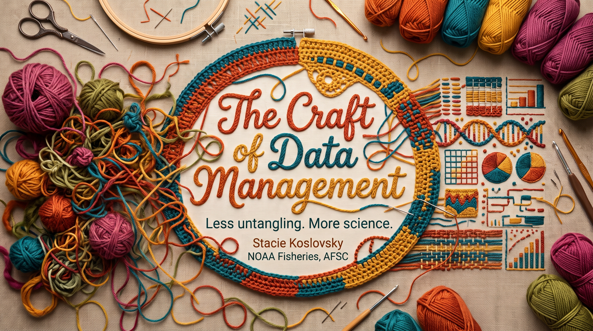

## Who I Am 

- **My Role:** Data Scientist* at AFSC Marine Mammal Lab
- **My Work:** primarily ice seal and harbor seal research
- **My Approach:** practical systems that support research
- **My Bias:** keep it simple and accessible

## How the Data Roles Work Together

```text
          ┌────────────────────────────────────────────────────────┐
          │                 1. GOVERNANCE & BLUEPRINT              │
          │           Data Architect  •  Governance Analyst        │
          └───────────────────────────┬────────────────────────────┘
                                      │ (Designs the system & rules)
                                      ▼
          ┌────────────────────────────────────────────────────────┐
          │                 2. THE RAW FOUNDATION                  │
          │                     Data Engineer                      │
          └───────────────────────────┬────────────────────────────┘
                                      │ (Moves & structures raw data)
                                      ▼
          ┌────────────────────────────────────────────────────────┐
          │                    THE STORAGE HUB                     │
          └─────────────────┬───────────────────┬──────────────────┘
                            │                   │
    (For Exploration & ML)  │                   │ (For Clean Business Data)
                            ▼                   ▼
      ┌───────────────────────────┐       ┌───────────────────────────┐
      │   4A. PREDICTIVE MATH     │       │    4B. DESCRIPTIVE TRENDS │
      │   Data Scientist (1560)   │       │        Data Analyst       │
      │  (Builds & tests models)  │       │  (Builds dashboards/KPIs) │
      └─────────────┬─────────────┘       └─────────────┬─────────────┘
                    │                                   │
            (Needs Production)               (Needs Business Context)
                    ▼                                   ▼
      ┌───────────────────────────┐       ┌───────────────────────────┐
      │    5A. DEPLOYMENT & AI    │       │     5B. STRATEGY & ROI    │
      │    ML Engineer (1560)     │       │      Business Analyst     │
      │ (Deploys code into apps)  │       │ (Translates to executive) │
      └───────────────────────────┘       └───────────────────────────┘
```
- Management and Program Analysis series (0304)
- Operations Research series (1515)

## The "Craft" of Data Management 

:::::: {.columns}

::: {.column width="50%"}
*Organize your supplies*

- Gather and purge
- Sort by type
- Give each supply a home
- Label and store
- Give yourself space for new materials
- Re-evaluate organization periodically
:::

::: {.column width="50%"}
*Start a new project*

- Gather materials
- Prepare the workspace
- Follow the pattern
- Document your progress
- Embrace early mistakes
- Celebrate the finished piece
:::

::::::

## "Tangled" Projects

{fig-align="center"}

## What is Your "Tangled" Project? 

Not necessarily a data project.

:::::: {.columns}

::: {.column width="40%"}
- A junk drawer
- A puzzle
:::

::: {.column width="60%"}
- A shoebox of receipts for taxes
- A bag of unfinished crafts
:::

::::::

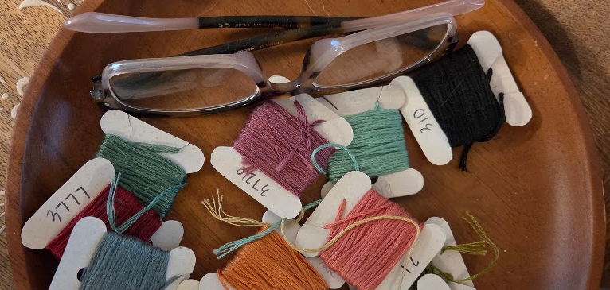{fig-align="center"}

## The Project is Tangled When...

- Finding things is difficult
- Knowing which version to trust is difficult
- Understanding variables is difficult
- Recreating results is difficult
- Handing work to someone else is difficult

**DISCUSSION: What is your tangled project?**

## The Untangling Tax 

You sit down to make something—but first:

- Find the right needle or hook.
- Untangle the thread or yarn.
- Identify the unlabeled material.
- Remember where you stopped.

*In Research*

Find the file. Decode the columns. Locate the script. Reconstruct the result.

## Why This Matters: Continuity 

Good data management helps us:

- Resume work after an interruption
- Respond to a reviewer months later
- Bring a new collaborator into a project
- Continue when a team member leaves
- Understand what supports a published result

*A gift to future-you—and whoever comes next.*

## File Organization

{fig-align="center"}

## Data Management Life Cycle

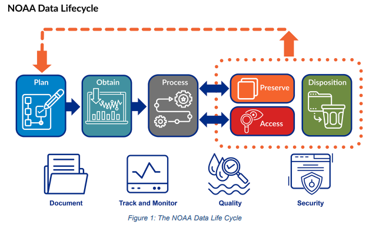{fig-align="center"}

Need to plan for storage for each step in workflow.

*You've done this before, but it can feel* **different or scary or intimidating** *when applied to digital files!*

## Guidance for (Re)Organizing 

- Plan and document before starting!
- Plan (at most) 3-4 levels deep in organizational structure.
- Minimize mouse-clicking/navigation (for 'like' information).
- Protect raw data.
- Let legacy be legacy.
- Don't move trash!

## (Re)Organizational Triage

1. Inventory what you have.
2. Classify the inventory (e.g. keep, legacy, delete).
3. Brainstorm different storage/folder structures.
4. Mock-up plans, if there is uncertainty or conflict.
5. Document what you plan to move where.

:::::: {.columns}
::: {.column width="70%"}
**Don't get caught in analysis paralysis!**

*Doing something is better than nothing!*

**Don't let the perfect be the enemy of the good!**
:::

::: {.column width="30%"}
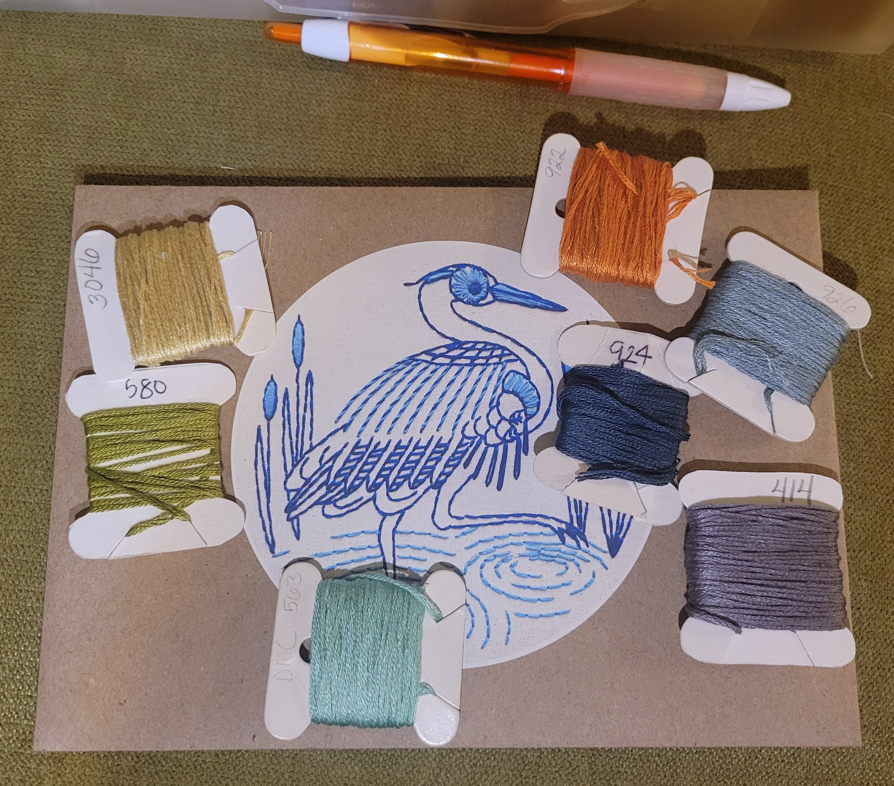{fig-align="center"}  
:::
::::::

## File Management: Start Small 

It's very easy to get overwhelmed.

**Start with a minimal, repeatable structure**

*There are many options; here are two.*

:::::: {.columns}

::: {.column width="50%"}
### Option 1
```text
my_research_project/
├── README.md
├── 00_planning/
├── 01_raw/
├── 02_processed/
├── 03_scripts/
├── 04_outputs/
└── 05_docs/
```
:::

::: {.column width="50%"}
### Option 2
```text
my_research_project/
├── README.md
├── Collection/
├── Data/
├── Docs/
├── Outputs/
├── Protocols/
└── Scripts/
```
:::

::::::

## File Management: Option 1 (of many)

High variation year-to-year within the same project

```text
species/
├── region_project_a/
│   ├── README.md
│   ├── 2023/
│   ├── 2025/
│   │   ├── 00_planning_sops/ (including everything related to fieldwork)
│   │   ├── 01_raw/
│   │   ├── 02_processed/
│   │   ├── 03_scripts/ (if not on GitHub)
│   │   ├── 04_outputs/ (with folders within for each output)
│   │   └── 05_docs/
│   └── 2026/
└── region_project_b/
    ├── README.md
    ├── 2018/
    ├── 2022/
    └── 2026/
``` 
**Our files are not nearly this organized!**

## File Management: Option 2 (of many)

High consistency within years, irregular reporting intervals

```text
species/
├── region_project_a/
│   ├── README.md
│   ├── 00_planning_sops/
│   ├── 01_data/
│   │   ├── 2023/
│   │   ├── 2025/
│   │   └── 2026/
│   ├── 02_scripts/ (if not on GitHub)
│   ├── 03_outputs/ (with folders within for each output)
│   └── 04_docs/
└── region_project_b/
    ├── README.md
    ├── 00_planning_sops/
    ├── 01_data/
    │   ├── 2018/
    │   ├── 2022/
    │   └── 2026/
    ├── 02_scripts/ (if not on GitHub)
    ├── 03_outputs/ (with folders within for each output)
    └── 04_docs/
```
**Our files are not nearly this organized!**

## Example: PEP Google Shared Drive

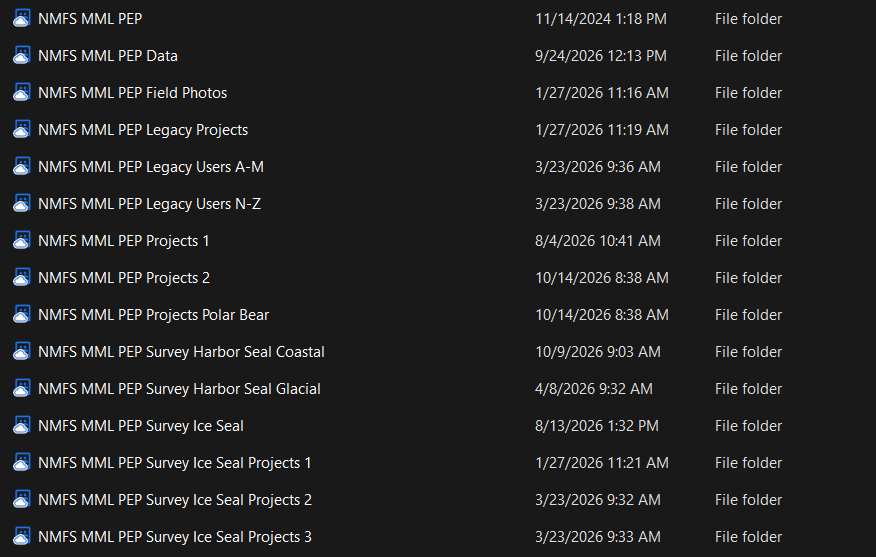{fig-align="center"}

## Example: PEP Google Shared Drive

:::::: {.columns}

::: {.column width="50%"}
*Projects*

Information to support collecting the data
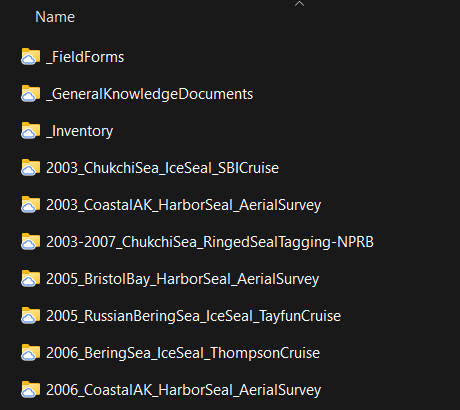{fig-align="center"}
:::

::: {.column width="50%"}
*Data*

Data collected and associated products
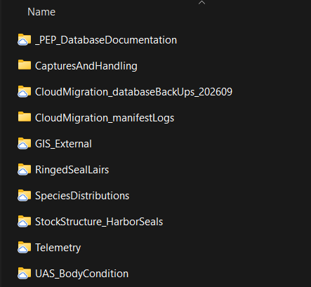{fig-align="center"}
:::

::::::

## File Management: Year Comparison 

:::::: {.columns}

::: {.column width="50%"}
### Year/Project 
```text
2024/
├── project_a/
├── project_b/
└── project_c/
2025/
├── project_a/
└── project_c/
2026/
├── project_b/
└── project_c/
```
:::

::: {.column width="50%"}
### Project/Year
```text
project_a/
├── 2024/
└── 2025/
project_b/
├── 2024/
├── 2025/
└── 2026/
project_c/
├── 2024/
└── 2026/
```
:::

::::::

**DISCUSSION: Which do you like better and why?**

:::{.fragment}
*Year/project requires memory or knowledge.*

*Project/year keeps a project together. Easier to on-board.*
:::

## Protect the Original Skeins 

*Raw data are evidence—not a workspace.*

- Name cleanly from the collection or immediately following.
- Preserve the original files or source exports.
- Write cleaning and transformations to separate locations (database!).
- Document corrections rather than silently overwriting.
- Restrict modification where the storage system supports it.

**Build workflows using "raw" data; store products elsewhere.**

## Example: Ice Seal Survey Data

1. Imagery and metadata collected in the field (*raw*)
2. Queries in DB: species counts, haulout locations, and survey effort (**processed**)
3. Outputs from running the imagery through a machine learning model (**processed**/*raw*)
4. Reviewed and reconciled outputs (**processed**)

## Example: Ice Seal Surveys

:::::: {.columns}

::: {.column width="50%"}
### Survey Data
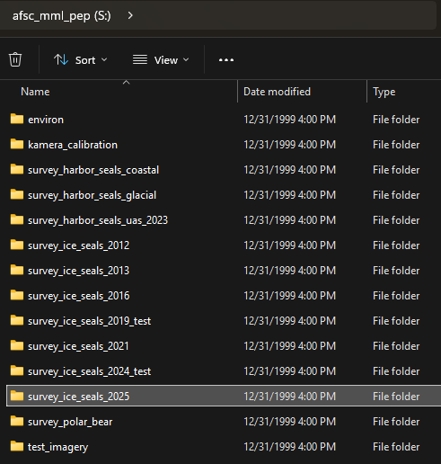{fig-align="center"}
:::

::: {.column width="50%"}
### Annotation Data
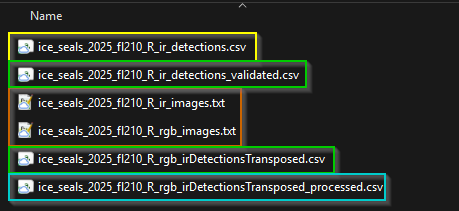{fig-align="center"}

          orange --> blue 
          raw --> processed

**Clear guidance of file naming within project documentation**

:::

::::::

## Naming Considerations

- Human-readable, but not too long
- Machine-readable, but not too short
- Sorts logically (e.g. YYYY-MM-DD rather than MM-DD-YYYY)
- Use a consistent order and separator of information (e.g. project_site_date)
- Use leading zeroes to ensure correct sorting (e.g. 01, 02, 03)
- Avoid abbreviations unless they are widely understood/documented
- Make as much consistent across projects, if possible

## Not Every Duplicate is a Mistake 

*Sometimes, you need extra supplies.*

- A local working cache
- A transfer or collaboration copy
- A fixed release
- An input snapshot for an analysis or model

Be intentional:

**Why are there duplicates? Which is authoritative? Which are copies? How is it updated or retired?**

## Bits and Bobs: Data Access

*Don't lock yourself into a rigid access scheme.*

- Read-only access for most users.
- Limit read-write access to those who need it.
- Maintain permissions by group, not user.
- Review access when roles change.

## Example: PostgreSQL DB Permissions

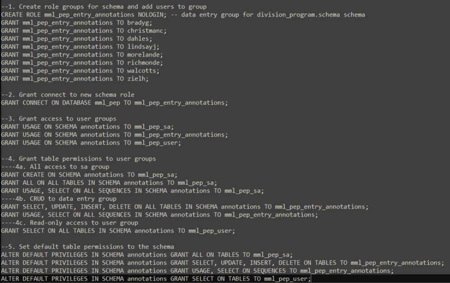{fig-align="center"}

## Storage Bins: Cloud Considerations

Where we store data is different than before. And how we access it is different than before.

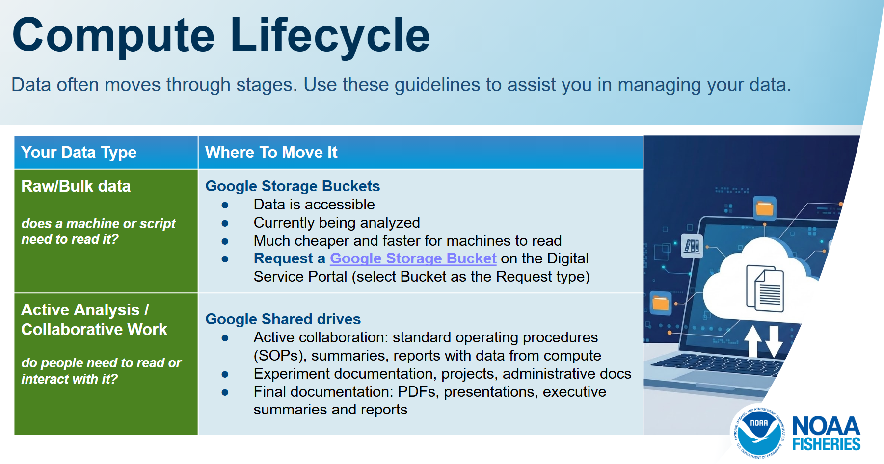{fig-align="center"}

**Need more explicit and clear guidance for what goes where**

## Browsing & Searching Together 

*Both are useful, so design for both.*

::: {.columns}
::: {.column width="50%"}
### Folders

- Provide a predictable home
- Preserve nearby context
- Support browsing
:::

::: {.column width="50%"}
### Search

- Find files across projects
- Filter by staff, year, region, species, or other metadata
- Descriptive file names are your friend!
:::
:::

**Keep the browseable home. Add another way to find things.**

## Give Yourself Extra Storage Space 

Currently, we have a 500k item limit on Google Shared Drives. 

*This is a hard limit, and you will get notice when you are approaching it.*

Keep this in mind as you are (re)organizing your files and folders on Shared Drives.

## The Expectation Test 

| Folder | **“What Do I Expect to Find Here?”** |
|---|---|
| `01_raw/` | Original inputs |
| `04_outputs/` | Generated results |
| `misc/` | Unclear |
| `final_final/` | Unclear |

The best folder structure is one that people can follow

...when they're busy.

...when they're working under a tight deadline.

...when the data lead is on vacation!

*Can also use this question to guide planning and discussion.*

## Example: Beluga Data Organization

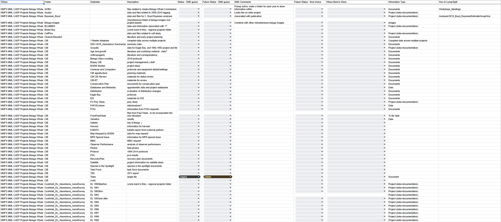{fig-align="center"}

## Example: Beluga Data Planning

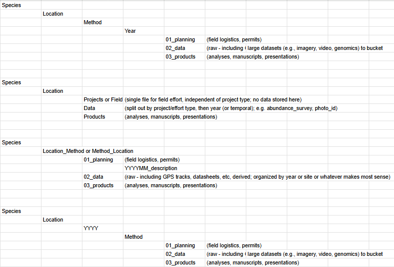{fig-align="center"}

## Actionable Next Steps

- Make it a priority, not a side project.
- Dedicate time for this work (e.g., schedule regular sessions, coworking, focused blocks).
- Provide a ready-made project template.
- Test it on one real project.
- Ask an unfamiliar colleague to try it.
- Revise confusing parts before wider rollout.

*When ideas conflict, test the task—not just the preference.*

## Give Yourself Grace

**It is hard to get it right the first time.**

::: {style="font-size: 0.5em;"}
It took three tries to get the PEP data organization "right".      
And we had lots of meetings to get there!
:::

*Be patient with yourself and others as you work to improve your data management practices!*

::: {style="font-size: 0.5em;"}
I literally bribed people with cookies to get them to help me organize the PEP data.
:::

**Do not require everyone to modernize everything at once.**

### Change is hard. It takes time to get it "right".

## Now That My Supplies Are Organized

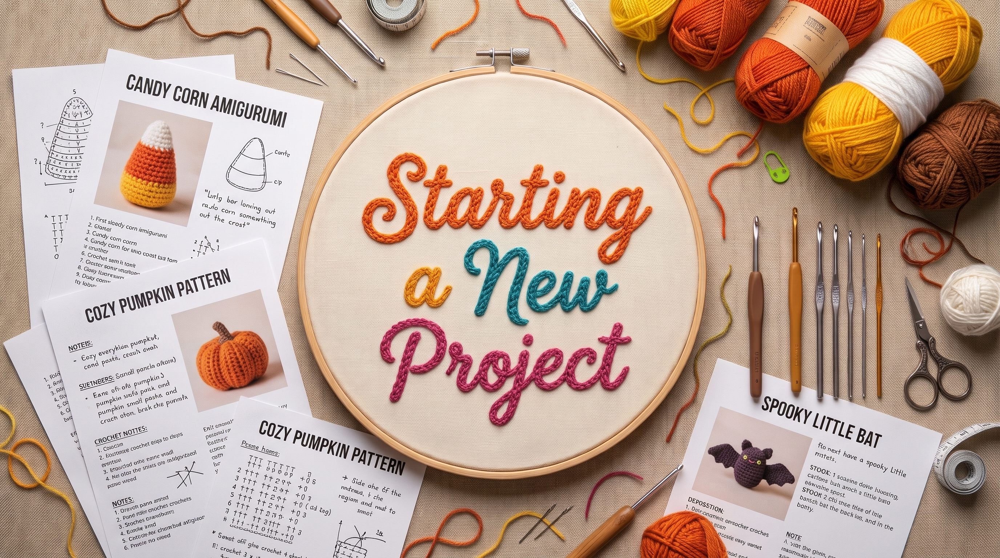{fig-align="center"}

We're going to make a candy corn amigurumi! 

(or a data product)

## Making a Candy Corn Amigurumi

- *Gather materials* - pick out your yarn colors
- *Prepare the workspace* - get your hook and pattern
- *Plan and document your process/progress* - Project Management
- *Follow the pattern* - Documentation
- *Embrace early mistakes* - Oops
- *Celebrate the finished piece* - Maintain and Preserve

## Project Management: Craft

*Crafting:* How am I going to complete all these holiday-related embroidery projects before I decorate for the holidays?

**SOLUTION: an unexpected 43-day pause in October 2025**

::: {style="font-size: 0.33em;"}
**(not recommended as a planning strategy)** 
:::

:::::: {.columns}
::: {.column width="30%"}
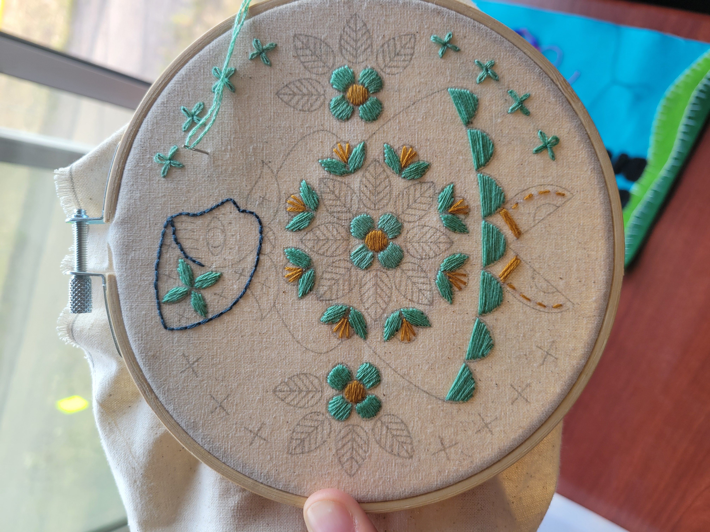{fig-align="center"}  
:::

::: {.column width="70%"}
{fig-align="center"}  
:::
::::::

## Project Management: Research
*Research:* How are we going to get all this work completed before the SAR deadline?

**SOLUTION: GitHub Projects**

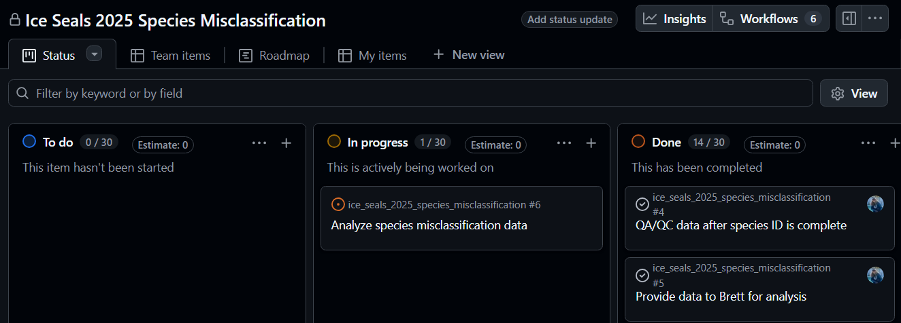{fig-align="center"}

## GitHub Projects

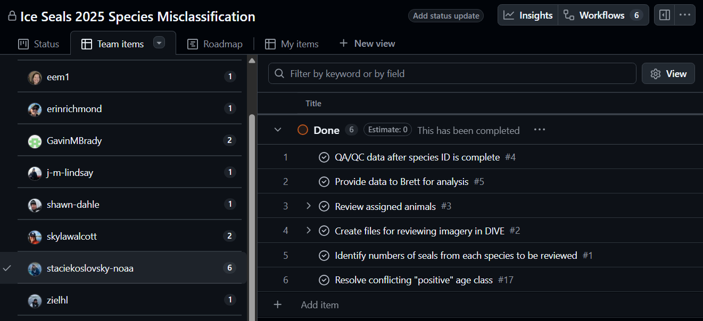{fig-align="center"}

## GitHub Projects

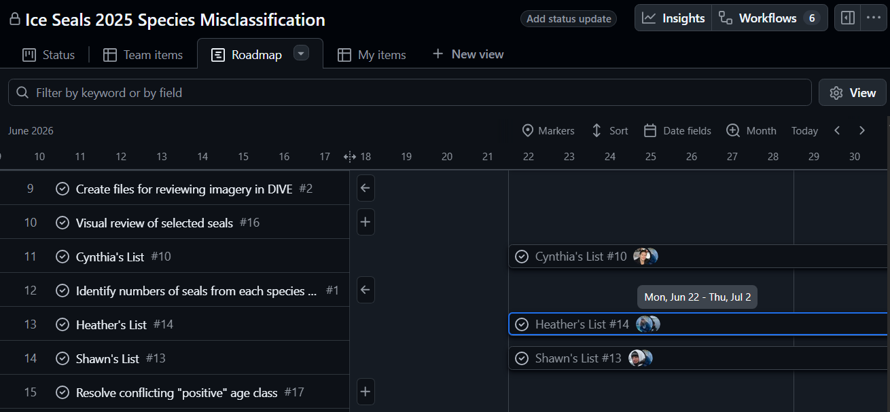{fig-align="center"}

*Project management helps set the tone for organizing and documenting your work, files, and data.*

## Documentation

- File names
- Data dictionaries
- README documents
- Workflow/SOP documentation
- Version control

*Takes time to write. Saves time when you need it later.*

## Keep the Label: clear file names

Instead of: `data_final_v2_edit.csv`

Try: `harbor_seal_counts_1998-2024_20261028.csv`

Agree on:

- What the date represents
- Stable project and site identifiers
- Consistent separators
- When a version or release label is needed

**A file name should make sense on its own.**

## Keep the Wrapper: a data dictionary 

| Variable | Meaning | Unit or allowed values |
|---|---|---|
| `haulout_id` | Location identifier | Site lookup table |
| `altitude_m` | Aircraft altitude | Meters |
| `count_dt` | Survey date/time | YYYY-MM-DD HH:MM:SS |
| `count` | # seals counted | Nonnegative integer |

Other information might include: 

*Missing values, quality flags, identifiers, and relationships.*

## Example: PEP Data Dictionary

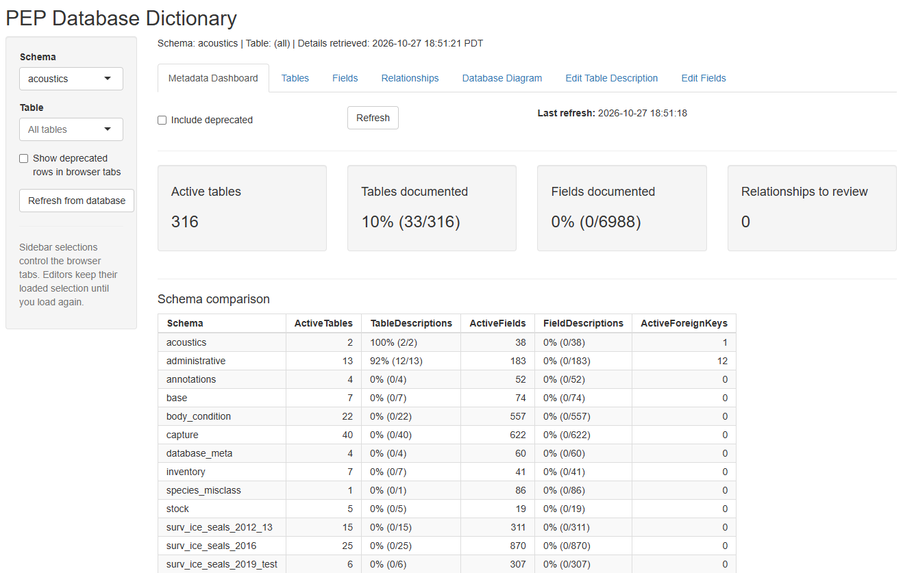{fig-align="center"}

## Example: PEP Data Dictionary
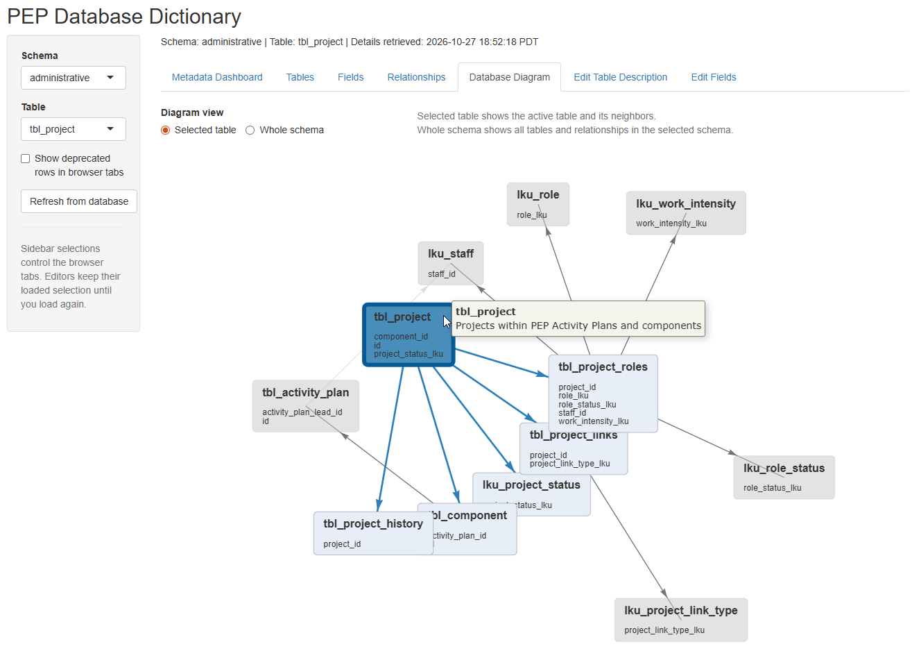{fig-align="center"}

## The Pattern: a README

A useful README answers:

- Folder structure (what's where)
- Naming scheme (how things are named)
- Link to project documentation/SOPs (how we did/do things related to these files)

*Write down what memory is currently supplying.*

## The Pattern Book: workflow/SOPs

*A README documents the contents.*

**The workflow/SOPs documents the process.**

1. What is this project?
2. Who maintains it?
3. Where did the data come from?
4. What do I run—and in what order?
5. What should the workflow produce?
6. What restrictions or known limitations apply?

## Record the Tools, Not Just Stitches

A pattern is incomplete without the hook size and gauge.

:::::: {.columns}

::: {.column width="65%"}
*For an analysis or workflow, record:*

- Software and package versions
- Environment or dependency files
- Parameters and configuration
- Execution order
- External inputs and services
:::

::: {.column width="35%"}
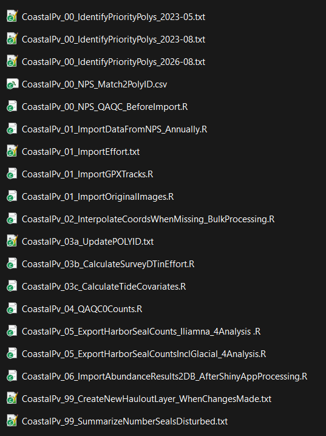{fig-align="center"}
:::

::::::

## Things Happen 

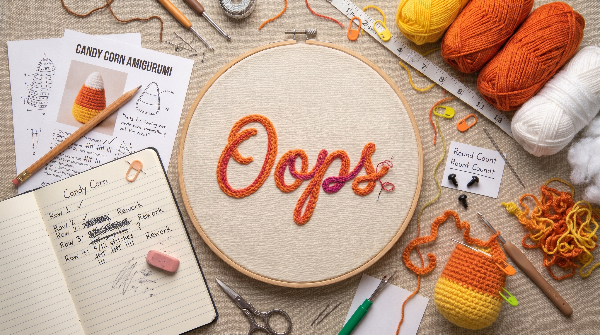{fig-align="center"}

## The Row Counter: version history 

Use version history to answer:

- What changed and why?
- Why did it change?
- Which version produced this result?
- Can we compare or recover earlier work?

**Git is useful for code and text.**

*Data need an appropriate versioning strategy, too.*

File naming? GitHub? Database tooling?

## Project Hand-off

*A half-finished project is not necessarily a problem.*

**A half-finished project with no consistency or notes is difficult to continue.**

A project handoff should identify:

- Original and processed data
- Working code and its environment
- The route from inputs to key outputs
- Known problems and unfinished work
- The next responsible person

## Two-minute Activity: The Handoff 



*Choose a project you know.*

Brainstorm:

1. One thing a new person would struggle to find
2. One fact that currently lives only in someone’s memory
3. One small change that would help next week

*Ask: “What would make the next stitch easier?”*

**DISCUSSION: Share one thing you wrote down.**

## You Did It!

{fig-align="center"}

## Finished Pieces Still Need Care...

*Preservation*

- What must remain usable?
- Which files and documentation belong together?
- Where is the approved long-term home?
- Who is responsible for access and maintenance?
- How will integrity and recovery be checked?

## ...and Occasionally, Mending

*Maintenance at useful milestones:*

- Before a new collaborator joins
- Before a major analysis or release
- Before publication or project closure
- Before a team member leaves

Review:

**Locations · Documentation · Access · Ownership · Recovery**

*A little regular care beats a large rescue effort later.*

## Lots of Information...Now What?

“Take a deep breath…and say ‘yeah, I can do that’”

~presenter at Posit::conf 2026

{fig-align="center"}

## Example: PEP Data Management Plan 

```{=html}
<iframe src="https://staciekoslovsky-noaa.github.io/pep_data_mgmt_plan/content/" width="100%" height="450px" frameborder="0"></iframe>
```
**This is 10 years in the making. Be patient!** [(link to plan)](https://staciekoslovsky-noaa.github.io/pep_data_mgmt_plan/content/)

## Less untangling. More science.

| Tangle | Solution |
|---|---|
| Finding things | Predictable organization |
| Knowing what to trust | Clear file naming |
| Understanding data | README and data dictionary |
| Recreating results | Versioning and history |
| Handing off the work | SOPs |

*What would make the next stitch easier?*